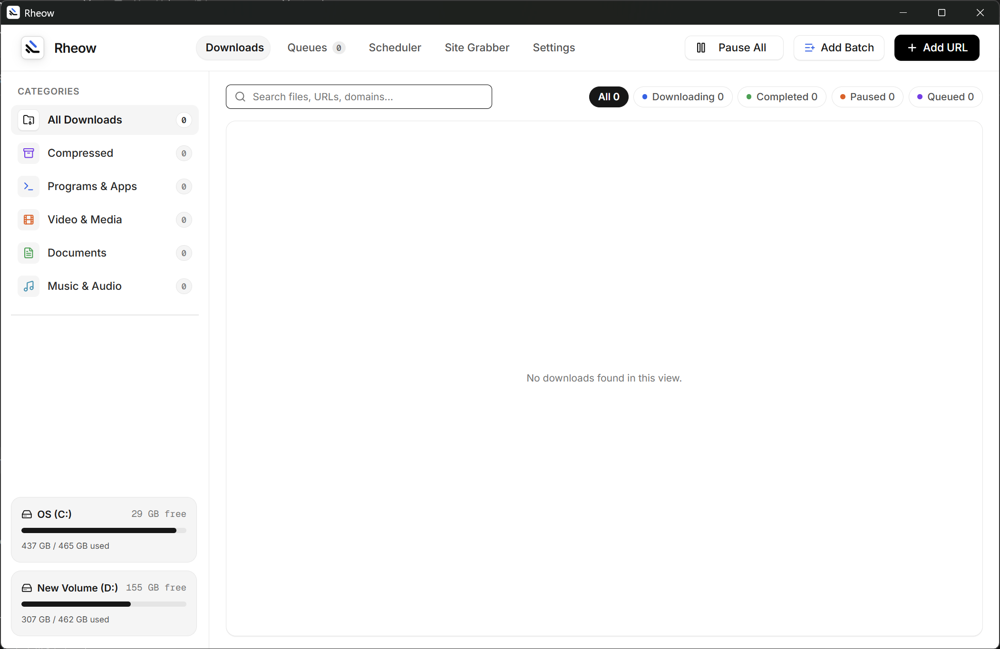
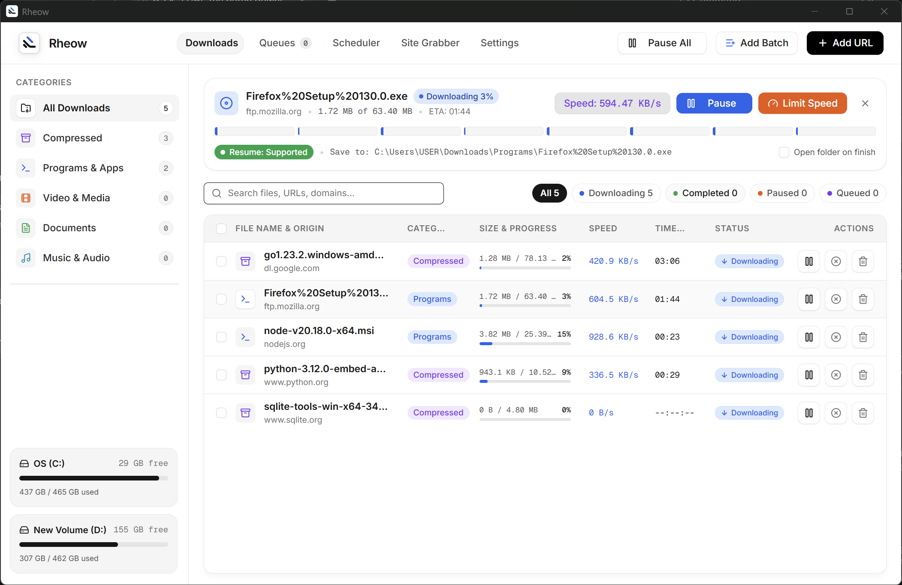

<p align="center">
  
</p>

<p align="center">
  
  
  
  
  <a href="LICENSE"></a>
</p>

# Rheow

A modern download manager for Windows, built with Rust (Tauri v2) and React 19.

Rheow downloads files through a multi-segment HTTP engine and displays progress inside a single dashboard. The backend uses `tokio` and `reqwest` to write incoming bytes directly into pre-allocated file space on disk, avoiding post-download file merging. A Manifest V3 browser extension routes downloads from Chromium-based browsers to the local app through a loopback HTTP bridge.

Pre-built setup installers are available on the [Releases](https://github.com/PIKAZZO18/Rheow-Download-Manager/releases/latest) page. You can also build the application directly from source.

## Screenshots



*Dashboard overview: category sidebar, status filter pills, and live per-drive storage meters.*



*Active downloads: multi-segment progress, per-file speed and ETA, inline pause and delete, plus the Resume Supported badge.*

---

## Features

- **Multi-segment range engine**: Up to 32 parallel connections with disk pre-allocation, writing chunks straight to disk offsets.
- **Single-window dashboard**: Real-time progress, speed, remaining time, and segment block visualizer in one interface without detached popup dialogs.
- **Queue and speed control**: Global connection limits, FIFO task queue, download speed limiter, pause, resume, and retry actions.
- **File categorization**: Routes downloads to `Compressed`, `Programs`, `Video`, `Documents`, `Music`, or `General` with customizable folders.
- **Browser integration**: Manifest V3 extension for Chrome, Edge, and Brave with right-click context menu interception via local bridge on `http://127.0.0.1:41789`.
- **First-run extension wizard**: Guided browser setup that opens your browser and verifies extension connectivity.
- **Windows toast notifications**: Interactive action buttons to open files, reveal folders, or retry failed downloads.
- **SQLite persistence**: Task states, chunk records, history, and user settings stored in `%APPDATA%\Rheow\rheow.db`.

---

## Tech Stack

| Layer | Technology |
|---|---|
| Desktop Framework | Tauri v2 |
| Backend | Rust, `tokio`, `reqwest`, `rusqlite`, `serde` |
| Frontend | React 19, TypeScript, Vite 8 |
| Styling | Tailwind CSS v4, Lucide Icons |
| Database | SQLite (bundled) |
| Browser Extension | Manifest V3 (Chrome, Edge, Brave) |
| Packaging | NSIS (Tauri bundler) |

---

## Repository Structure

```text
.
├── LICENSE
├── README.md
├── rheow-horizontal-dark.png
└── Rheow/
    ├── docs/screenshots/       # README screenshots
    ├── extension/              # Manifest V3 browser extension
    ├── public/                 # Static assets and brand icons
    ├── scripts/                # Bridge and integration test scripts
    ├── src/                    # React frontend
    └── src-tauri/              # Rust backend and Tauri configuration
```

---

## Prerequisites

To build Rheow from source, ensure you have:

- **Windows 10 / 11 x64**
- **Node.js 20.19+** (or 22.12+) and npm
- **Rust** toolchain `stable-x86_64-pc-windows-msvc`
- **Visual Studio Build Tools** with the *Desktop development with C++* workload
- **WebView2 Runtime** (pre-installed on Windows 10 and 11)

For environment setup details, see the [Tauri Prerequisites Guide](https://tauri.app/start/prerequisites/).

---

## Build and Run

Run development mode:

```powershell
cd Rheow
npm ci
npx tauri dev
```

Build the NSIS setup installer:

```powershell
cd Rheow
npm ci
npx tauri build
```

The installer will be generated at:

```text
Rheow\src-tauri\target\release\bundle\nsis\Rheow_1.1.1_x64-setup.exe
```

To build only the standalone binary without packaging:

```powershell
cd Rheow
npx tauri build --no-bundle
```

The executable will be located at `Rheow\src-tauri\target\release\rheow.exe`.

> Note: `npm run build` only compiles the frontend into `dist/`. Use `npx tauri build` to compile the complete desktop application.

---

## Testing

Run Rust unit and integration tests:

```powershell
cd Rheow\src-tauri
cargo test
```

Run engine integration tests:

```powershell
cd Rheow\src-tauri
cargo test --test engine_test -- --nocapture
```

Run extension end-to-end tests (requires Rheow desktop app running):

```powershell
cd Rheow
npm run test:e2e
```

Run HTTP bridge security test matrix (requires Rheow desktop app running):

```powershell
cd Rheow
powershell -ExecutionPolicy Bypass -File .\scripts\test-bridge.ps1
```

---

## Browser Extension

The Rheow desktop installer packages the browser extension. On first launch, the setup wizard:

1. Copies extension files to `%LOCALAPPDATA%\com.rheow.app\browser-extension`.
2. Opens your default Chromium-based browser.
3. Guides you to open `chrome://extensions` or `edge://extensions`, enable **Developer mode**, and click **Load unpacked**.
4. Verifies the connection between browser and desktop engine.

You can reopen this wizard at any time from **Settings -> Browser -> Open wizard**.

For local development, load the `Rheow\extension` directory as an unpacked extension in Chrome, Edge, or Brave.

---

## Installing and Updating

New installs use a per-user NSIS installer and do not require administrator rights. Existing per-machine installs should be uninstalled once before installing `1.1.0`, so the updater can replace files without elevation.

New installs enable **Launch Rheow at Windows sign-in** by default. You can turn it off, or enable **Start minimized in the tray**, in **Settings -> Desktop**.

Rheow checks GitHub Releases shortly after startup and every 24 hours. Updates are verified with a Tauri signing key, downloaded only after you click **Download**, and installed only after you confirm. Active downloads are paused with your permission, and the database is backed up to `%APPDATA%\Rheow\backups` before the installer runs. Automatic checks can be disabled in **Settings -> Updates**.

### Windows SmartScreen

The installer is not Authenticode-signed, so Windows may show **Windows protected your PC** with **Unknown publisher**. This is separate from Tauri's update signature, which verifies update packages inside Rheow. Before running the installer, compare its SHA-256 with the value published in the release notes:

```powershell
Get-FileHash .\Rheow_1.1.1_x64-setup.exe -Algorithm SHA256
```

If the hash matches, choose **More info -> Run anyway**.

---

## License

This project is licensed under the [MIT License](LICENSE).
